<picture>
  <source media="(prefers-color-scheme: dark)" srcset="assets/banner-dark.png">
  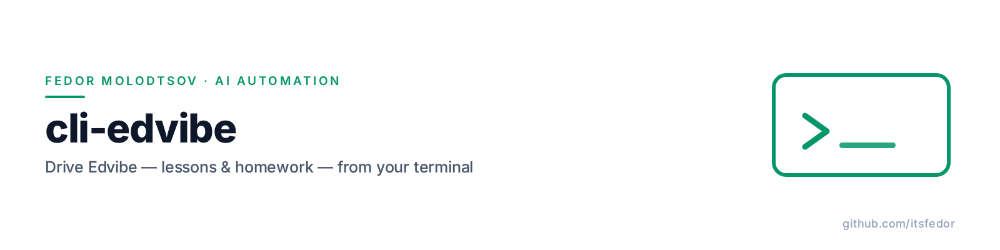
</picture>

<p align="center"><sub><b>Fedor Molodtsov</b> — AI automation engineer · <a href="https://github.com/itsfedor">github.com/itsfedor</a></sub></p>

# ⌨️ cli-edvibe: drive Edvibe from your terminal

**Edvibe (ex-ProgressMe) has no public API. This is a CLI for it — lessons, homework, students, analytics, from the command line.**

[](https://www.python.org/)
[](LICENSE)
[](#tests)
[](#command-reference)
[](#agent-skills)

> **Unofficial and unaffiliated.** This tool talks to Edvibe's private API,
> which it reverse-engineered. It is not endorsed by, connected to, or supported
> by Edvibe / ProgressMe. Use it with your own account and data, at your own
> risk, and check that it fits the platform's terms for your use case.

Everything a teacher does in the Edvibe cabinet — building a unit, attaching
homework, reading what a student sent back, checking who dropped out, editing
the public landing page — goes through a private WebSocket RPC gateway. This
project reverse-engineered that protocol and wrapped it in 57 commands, so a
lesson can be authored as JSON and built in one call, and a student's voice
recording can be transcribed before the next class.

In daily use for a working ESL practice: four levels of a grammar series, an
IELTS course and a speaking course are all built and maintained through it.

> **What's in this release:** school analytics (`school …`), the teacher landing
> page (`site …`), voice transcription (`audio transcribe`), read-only lesson
> backups (`lesson dump`), cover and section/lesson artwork (`book …`), and
> 14 new exercise templates — 31 types in total.

## Install

Requires **Python 3.9+**. Three dependencies, no Node, no server.

```bash
pipx install git+https://github.com/itsfedor/cli-edvibe
cli-edvibe login        # asks for email + hidden password, once
cli-edvibe doctor       # six checks, including a live login
```

`login` caches a session token at `~/.edvibe/session.json` (mode 600). The
password is never stored. For scripts, `EDVIBE_EMAIL` / `EDVIBE_PASSWORD` in the
environment do the same job.

Optional extras, only if you use those commands:

```bash
pipx install "cli-edvibe[branding] @ git+https://github.com/itsfedor/cli-edvibe"   # covers, icon tiles (Pillow)
cli-edvibe audio transcribe ...   # needs DEEPGRAM_API_KEY (env or ~/.edvibe_env)
```

*Already using the [ESL Automation Suite](https://github.com/itsfedor/esl-automation-suite)?*
Its setup script installs this same CLI from a bundled wheel.

## The nine use cases

Every GIF below replays the exact output of the command printed above it,
captured from live runs against a real school account. E-mail addresses and
student names are masked; anything that writes is shown with `--dry-run`.

### 1 · Check the session before you trust it

Six checks — Python, three dependencies, the session file, a live login. If
`doctor` prints six `[OK]` lines, every other command will work; if one fails,
it tells you which.

```bash
cli-edvibe doctor
cli-edvibe whoami
```

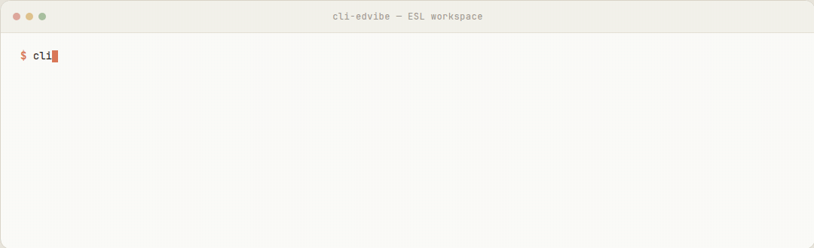

### 2 · Find any material, including the ones inside folders

`materials list` shows books and library folders; books that live *inside* a
folder are hidden from that list, so `materials folders --books` opens them.
`materials move --book ID --folder ID` re-files one book and reads the result
back.

```bash
cli-edvibe materials list
cli-edvibe materials folders --books
```

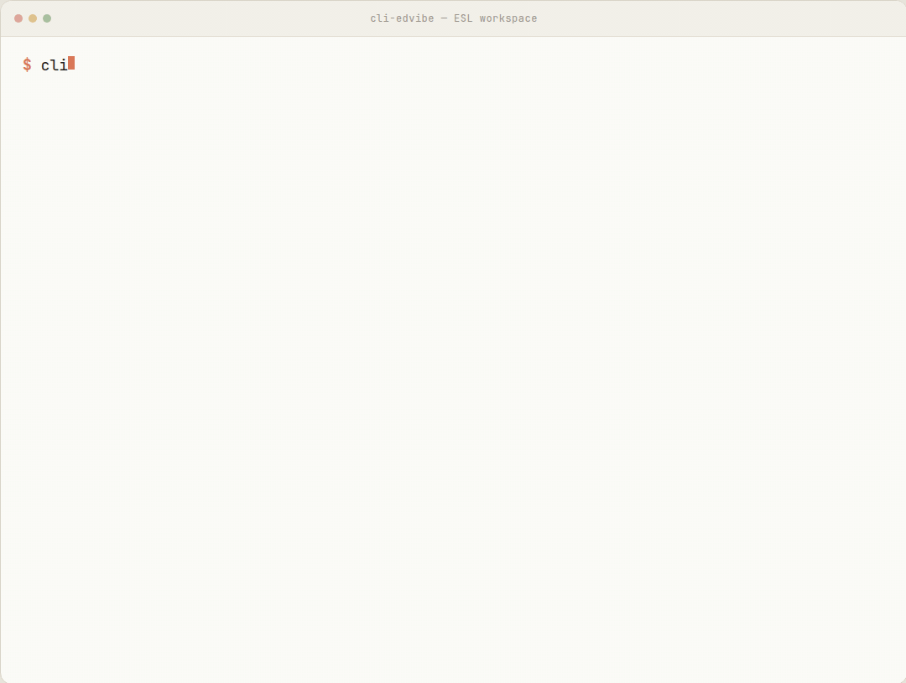

### 3 · Build a whole lesson from one JSON file

One spec describes sections and exercises; `lesson build` creates the lesson,
its sections and every exercise in order. `--dry-run` validates the spec and
prints the plan without touching the account. Start from
[`examples/lesson-small-talk.json`](examples/lesson-small-talk.json) — a 4-section,
15-exercise B1 lesson.

```bash
cli-edvibe lesson build --file small-talk.json --material 1206451 --dry-run
cli-edvibe lesson build --file small-talk.json --material 1206451     # for real
```

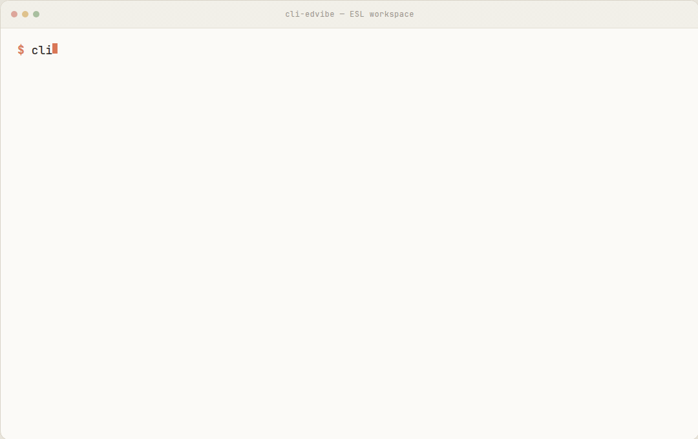

### 4 · Pull a test-english.com lesson into your book

`test-english import` scrapes the explanation page and both exercise pages,
rebuilds them as native Edvibe exercises, and puts the answer keys in hidden
teacher notes. Re-running with `--replace-sections` rebuilds the same lesson
idempotently.

```bash
cli-edvibe test-english import "https://test-english.com/grammar-points/a1/present-simple/" \
    --book "test-english A1" --section grammar --dry-run
```

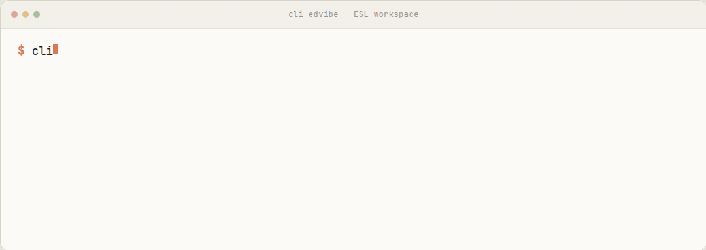

### 5 · Give homework in one command

`homework give` pins the unit to the class (the cabinet's "Pin this unit"),
provisions the homework sheet on first use, and attaches the exercises in
lesson order. With `--file` it first creates that spec's exercises in the
lesson's homework pool, reusing any exercise with the same type and name — so a
re-run for the second student in a pair never duplicates content.

```bash
cli-edvibe homework give --lesson 19785501 --class-id 2227632 --pupil 3410766 \
    --file hw.json --dry-run
```

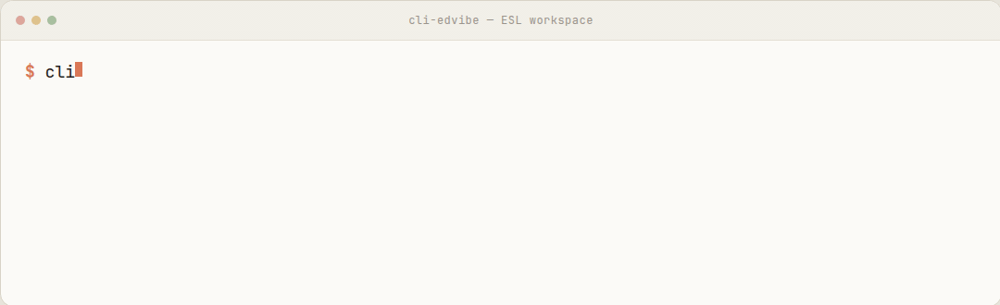

### 6 · Read what the student actually sent

`homework show` lists the sheet's exercises; `homework answers` returns the
submitted answers themselves — the voice-recording mp3 (public CDN), the essay
text, the typed gaps — and `audio transcribe` runs Deepgram Nova-3 in
`language=multi`, so a Russian sentence in the middle of an English answer comes
back in Cyrillic with word timings, pauses, filler counts and speaking rate.

```bash
cli-edvibe homework show --lesson 19785501 --pupil 3410766 --class-id 2227632
cli-edvibe audio transcribe voice.m4a
```

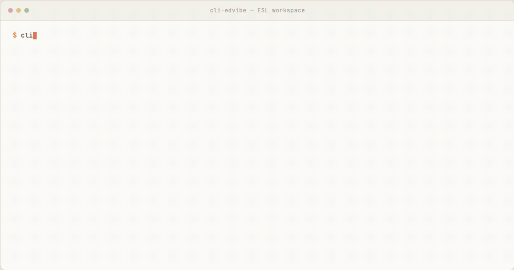

### 7 · See the whole school at a glance

`school overview` counts pupils, classes and courses; `school classes` lists
them; and `school course`, `dropoff`, `retention` and `rating` go per-pupil and
per-lesson — readable even on courses where the platform's statistics export was
never switched on.

```bash
cli-edvibe school overview
cli-edvibe school classes
```

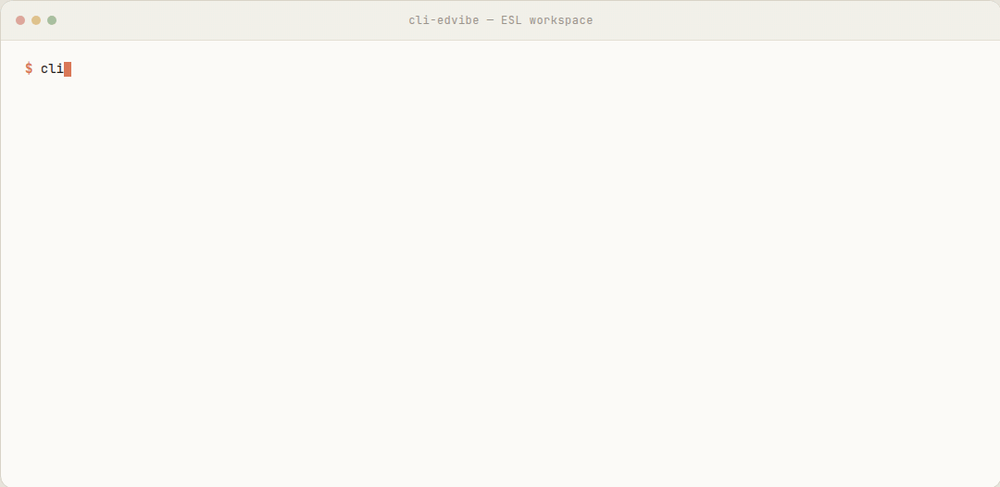

### 8 · Back up a lesson before you touch it

`lesson dump` writes every exercise of a lesson to one JSON file, hidden teacher
notes and their HTML included, using read RPCs only. Twenty seconds before a
rebuild; a diffable snapshot afterwards.

```bash
cli-edvibe lesson dump --lesson 19785501 --out lesson-19785501.json
```

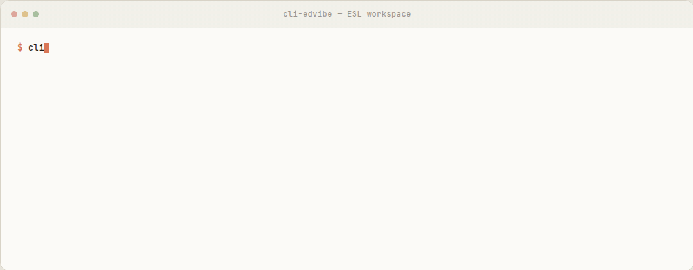

### 9 · Run the teacher landing page from the terminal

Every Edvibe teacher gets a public site («Сайт и заявки»). `site show` reads the
blocks and the publishing state; `site edit` applies a patch — backup first, save
second, read-back diff after — and `--publish` makes it live. `site requests`
lists the trial-lesson applications the page collected.

```bash
cli-edvibe site show
cli-edvibe site edit --file patch.json --dry-run
cli-edvibe site requests --take 10
```

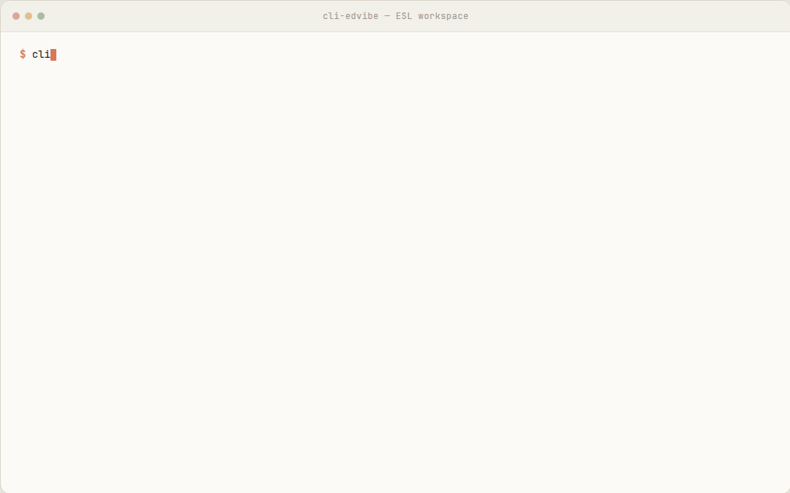

## Command reference

57 commands, grouped the way the cabinet is. `--json` works anywhere for
machine-readable output; a bare `cli-edvibe` opens a REPL.

**Session**

| Command | What it does |
|---|---|
| `doctor` | python, dependencies, session file, live login |
| `login [--check]` / `logout` / `whoami` | log in once / forget the token / who am I |

**Materials (books) and the library**

| Command | What it does |
|---|---|
| `materials list` | books and library folders |
| `materials folders [--books]` | folder ids, counts, and the books inside |
| `materials create "Name"` | create a book |
| `materials move --book ID --folder ID [--dry-run]` | move a book into a folder, read-back verified |

**Lessons (units)**

| Command | What it does |
|---|---|
| `lesson add --material ID --name "Unit 1"` | add a unit (creates its first section) |
| `lesson show --lesson ID` | sections and exercises |
| `lesson build --file spec.json (--material ID \| --lesson ID)` | a whole lesson from JSON, `--dry-run` to plan |
| `lesson dump --lesson ID [--out FILE] [--section NAME]` | read-only snapshot of every exercise |
| `content show --lesson ID --section ID` | exercises in one section |
| `content add-note --lesson ID --section ID --file note.html` | raw HTML content block |
| `content upload-image FILE` / `content upload-audio FILE` | media upload, returns the CDN URL |
| `content attach-audio --exercise ID FILE...` | bind mp3s to an Audio exercise |

**Homework**

| Command | What it does |
|---|---|
| `homework give --lesson ID --class-id ID --pupil ID [--file spec \| --section ID \| --exercises 1,2,3]` | pin + provision + attach, one command |
| `homework add --file spec.json [--dry-run]` | append exercises to one pupil's sheet |
| `homework attach --lesson ID --pupil ID --class-id ID [--section ID]` | attach existing lesson exercises |
| `homework show --lesson ID --pupil ID --class-id ID` | the pupil's sheet |
| `homework pool --lesson ID` | exercises waiting in the lesson's homework section |
| `homework answers [--student NAME \| --pupil ID --class-id ID] [--only-answered]` | submitted voice / writing / typed answers |
| `homework download ... --out DIR` | recordings + texts + `manifest.json` |

**Students, classes, school**

| Command | What it does |
|---|---|
| `students list [--search NAME] [--take N]` / `students show ID` | roster / one profile with classes |
| `classroom show --student NAME` | current lesson + homework overview |
| `school overview` | pupils, classes, courses by size |
| `school pupils [--type N]` / `school classes` / `school marathons` | rosters and lists, `--out` CSV |
| `school stats [--school-wide \| --class-id \| --marathon-id]` | the server's statistics export |
| `school course --marathon-id ID [--curve] [--students]` | per-pupil completion, no statistics needed |
| `school dropoff --marathon-id ID` | lesson-by-lesson drop-off |
| `school retention` / `school rating` | completion metrics / points rating |

**Book branding** *(needs `[branding]`)*

| Command | What it does |
|---|---|
| `book sections --book ID` | the book's sections and lesson counts |
| `book cover --book ID FILE` | set the cover |
| `book section-icon` / `book lesson-icon` / `book apply-icons` | gradient tiles for sections and lessons |
| `book cutout SRC DST [--tol N]` | cut a flat background off a PNG, holes included |
| `book gen-icons --spec spec.json --out DIR` | render a whole icon grid *(needs `[render]`)* |

**Teacher landing page**

| Command | What it does |
|---|---|
| `site show` / `site backup` | blocks, meta, publishing state / timestamped snapshot |
| `site edit --file patch.json [--dry-run] [--publish]` | patch blocks and meta with backup + read-back |
| `site block on\|off --type NAME` / `site meta` / `site policy` | one-block toggles, meta tags, legal documents |
| `site publish` / `site requests` | push live / trial-lesson applications |

**Import and audio**

| Command | What it does |
|---|---|
| `import --html handout.html` | HTML handout → new book, one Note per `<h2>` |
| `test-english fetch URL` / `test-english import URL --book NAME --section grammar` | scrape / transfer a test-english lesson |
| `audio transcribe FILE\|URL [--language multi\|en\|ru] [--out JSON]` | Deepgram Nova-3: transcript, timings, pauses, fillers, wpm |

## Agent skills

The CLI is the hands; the skills are the instructions. One lives here, three in
the same suite:

| Skill | Lives in | What it teaches the agent |
|---|---|---|
| [`cli-edvibe`](skills/cli-edvibe/SKILL.md) | this repo | the command surface, spec format, and the rules (additive only, never delete) |
| `edvibe-teacher` | [esl-automation-suite](https://github.com/itsfedor/esl-automation-suite) | chat → lesson: draft a spec, build it, give homework, check the classroom |
| `tv-episode-homework` | [esl-automation-suite](https://github.com/itsfedor/esl-automation-suite) | a TV episode → script, vocabulary, homework set, per-episode series |
| `esl-video-review-summary` | [esl-automation-suite](https://github.com/itsfedor/esl-automation-suite) | video review lesson → summary homework |

```bash
npx skills add itsfedor/cli-edvibe -g -y --copy -a hermes-agent
npx skills add itsfedor/esl-automation-suite --skill edvibe-teacher --skill tv-episode-homework -g -y --copy -a hermes-agent
```

Works with Hermes Agent, Claude Code, Codex and anything else that reads
`SKILL.md`.

## Specs

Both `lesson build` and `homework add` take plain JSON. A lesson spec:

```json
{
  "lesson_name": "Small talk at work",
  "description": "B1 · 60 min",
  "sections": [
    {"name": "Warm-Up", "exercises": [
      {"type": "note", "name": "Today's goal", "color": "green", "html": "<p>...</p>"},
      {"type": "wordlist", "entries": [["catch up", {"0": "обсудить новости"}]]},
      {"type": "match", "instruction": "Match", "pairs": [["catch up", "talk about recent news"]]}
    ]},
    {"name": "Practice", "exercises": [
      {"type": "chooseoption", "lines": ["How's it [going*/going on/went]?"]},
      {"type": "filltyped", "sentences": ["Sorry, I'm [in] a hurry."]},
      {"type": "test", "timer_min": 5, "questions": [
        {"q": "Best reply?", "options": ["Not much", "Pretty good — you?"], "correct": [1]}]}
    ]}
  ]
}
```

A section named `Homework` is written into the lesson's built-in homework
section instead of a stage section.

A homework spec targets one pupil's sheet:

```json
{
  "lesson_id": 12345678,
  "pupil_id": 23456789,
  "class_id": 34567890,
  "homework_lesson_id": 45678901,
  "exercises": [{"type": "truefalse", "statements": [["...", true]]}]
}
```

**31 exercise types.** `note` `text` `topic` `video` `wordlist` `writing` `match`
`filltyped` `fillbox` `chooseoption` `wordorder` `sortcolumns` `ordersentences`
`truefalse` `test` `voice` `button` `pictures` `unscramble` `audio` `gif` `label`
`labelfill` `labelchoose` `miro` `googlepdf` `wordwall` `learningapps` `genially`
`baamboozle` `quizlet` — plus aliases (`tf`, `quiz`, `gaps`, `listening`, `pdf`,
`board`, …). Test timers (1–90 min) and per-question points, note colours,
carousel galleries and multilingual wordlists are spec options.

Field-by-field reference: [`lesson_spec.py`](cli_edvibe/core/lesson_spec.py),
[`homework_spec.py`](cli_edvibe/core/homework_spec.py), and the worked example in
[`examples/`](examples/).

## How it works

<p align="center">
  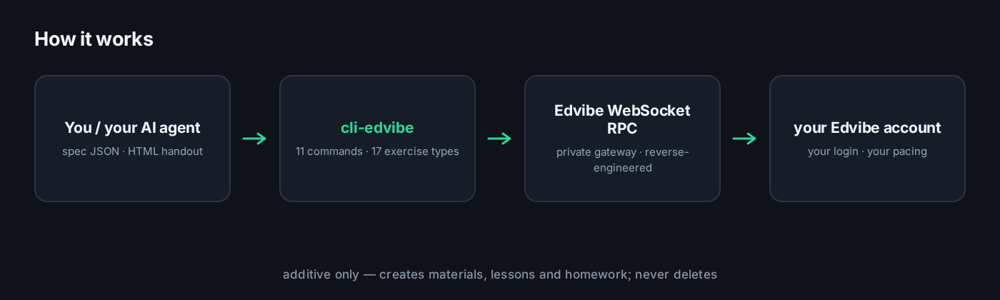
</p>

- **Transport** — WebSocket `wss://proxy-a.edvibe.com/websocket?token=...`;
  requests are `{Controller, Method, ProjectName, RequestId, Value}` frames, and
  the `Auth-Token` is a client-minted UUIDv4 (no server handshake).
- **Model** — Book → Course → Lesson(unit) → Section → Exercises; content blocks
  are `Note` exercises holding HTML. Homework is a separate microservice with one
  sheet per (lesson, pupil/class).
- **Login** — two RPCs on `AccountWsController`: `GetAccountRoles` → `Login`.
- **Pacing** — every call waits a jittered 0.8–2.0 s and the client caps at
  150 calls/hour per process, so traffic looks like one teacher working by hand.

The protocol write-up, with the GUI-action → command mapping, is in
[`EDVIBE.md`](EDVIBE.md).

## Safety

- **Additive only.** There is no delete command by design. The one destructive
  path — `test-english import --replace-sections` — only rebuilds sections it
  created, and the tests only ever create `CLI-HARNESS-*` objects.
- **Writes are reversible and logged.** `site edit` makes a timestamped backup
  before saving and prints a read-back diff; `materials move` re-reads the
  location; `book cover` and the icon commands verify the uploaded file's md5
  against the CDN copy.
- **Credentials stay local.** Only the session token is cached
  (`~/.edvibe/session.json`, mode 600). Passwords and the Deepgram key are read
  from the environment or `~/.edvibe_env` and never printed.

## Requirements

| | |
|---|---|
| Python | 3.9+ |
| Runtime deps | `requests`, `websocket-client`, `click` |
| `[branding]` | Pillow — `book cover`, icon tiles, `book cutout` |
| `[render]` | Pillow + Playwright — `book gen-icons` |
| `audio transcribe` | `DEEPGRAM_API_KEY` |
| `test-english import` | network access to test-english.com |

## Tests

```bash
python -m pytest cli_edvibe/tests/test_core.py \
                 cli_edvibe/tests/test_homework_spec.py \
                 cli_edvibe/tests/test_landing.py \
                 cli_edvibe/tests/test_school.py \
                 cli_edvibe/tests/test_test_english.py \
                 cli_edvibe/tests/test_asr.py \
                 cli_edvibe/tests/test_homework_answers.py \
                 cli_edvibe/tests/test_book_branding.py \
                 cli_edvibe/tests/test_folders_dump.py -q     # 142 offline tests

EDVIBE_EMAIL=... EDVIBE_PASSWORD=... \
  python -m pytest cli_edvibe/tests/test_full_e2e.py -v      # 5 live tests
```

The offline suite runs in under two seconds with no network. The live suite runs
against your own account and creates only fresh `CLI-HARNESS-E2E` objects. Test
history is in [`tests/TEST.md`](cli_edvibe/tests/TEST.md).

## A note on the platform

This is an unofficial tool: the protocol was recovered by studying the web
client's traffic. Edvibe can change it at any time — `doctor`, the tests and the
read-back checks after every write make breakage obvious rather than silent. If
you're the platform and you'd like something changed here, open an issue.

## License

[MIT](LICENSE)
